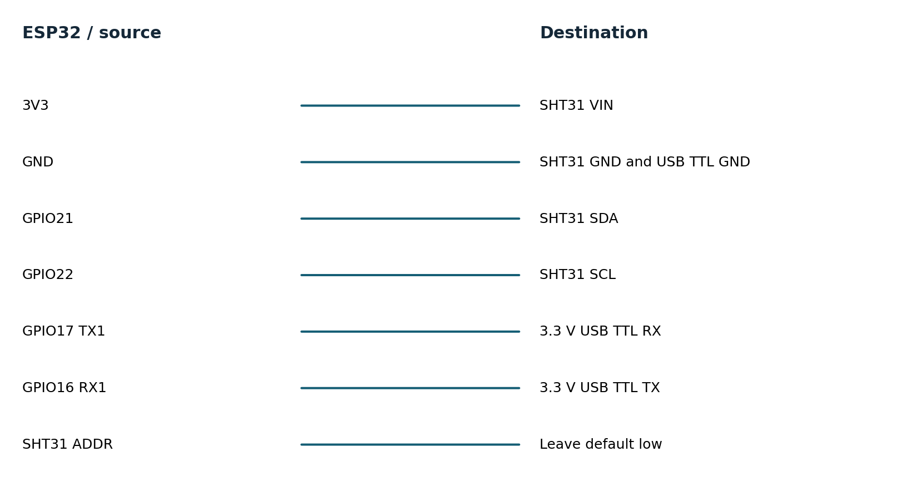

# Environmental telemetry logger hardware guide

No hardware was connected. This design is ready for a later bench build. Use a classic ESP32-WROOM DevKitC; GPIO16/17 can be unavailable on WROVER variants.

## Bill of materials

| Component | Qty | Cost |
|---|---|---|
| ESP32 DevKitC WROOM 4 MB | 1 | USD 10-18 estimate |
| Adafruit SHT31 2857 | 1 | USD 13.95 observed |
| 3.3 V USB TTL adapter | 1 | USD 5-12 estimate |
| USB cable, breadboard, jumpers | 1 set | USD 3-5 estimate |

Costs are USD planning estimates except the cited sensor prices observed on 2026-11-11. Tax, shipping, computer and test equipment are excluded. One board can be reused across the portfolio.

## Wiring

| ESP32 or source | Destination | Notes |
|---|---|---|
| 3V3 | SHT31 VIN | Pull-ups must be to 3.3 V |
| GND | SHT31 GND and USB TTL GND | Common reference |
| GPIO21 | SHT31 SDA | I2C data; breakout pull-up provided |
| GPIO22 | SHT31 SCL | I2C clock; breakout pull-up provided |
| GPIO17 TX1 | 3.3 V USB TTL RX | Telemetry to gateway |
| GPIO16 RX1 | 3.3 V USB TTL TX | Acknowledgment from gateway |
| SHT31 ADDR | Leave default low | Address 0x44; not 0x45 |

Use 3.3 V signaling, short leads and a common ground. Do not connect GPIOs directly to mains equipment or industrial 5/12/24 V outputs. Start with a bench pulse source or isolated low-voltage rig. Use USB power for initial bring-up; battery charging and protection are outside this prototype.

## Tools for physical validation

- Required for assembly: data-capable USB cable, breadboard/jumpers, multimeter; soldering tools if breakout headers are not fitted.
- Required for timing claims: logic analyzer with at least 10 MHz sampling for 2 MHz SPI; 20 MHz or more is preferable.
- Required for pulse fidelity: calibrated function generator or second MCU, checked with a logic analyzer.
- Required for power claims: current profiler or suitable shunt plus oscilloscope, bench supply and a measured battery specification.
- Optional firmware debugging: ESP-Prog JTAG adapter; serial diagnostics suffice for the initial experiments.

## Acceptance experiments

1. Measure current with a current profiler or shunt and oscilloscope over 30 complete wake/sleep cycles, disconnecting USB and avoiding back-power from UART. Integrate current over time. Report board input voltage, active time and mean sleep current before estimating battery life.

2. Disconnect the gateway for 20 wakes, restore it and compare generated sequence IDs with database rows. Then exceed 32 queued records to confirm newest-sample drops. Interrupt power during NVS save and after gateway commit but before ACK; inspect duplicates and retained records.

3. Hold SDA low and remove the sensor independently. Confirm bounded wake duration and no malformed record. Restore the sensor and measure the next valid wake. Force a watchdog timeout in a disposable test build and record reset reason.
