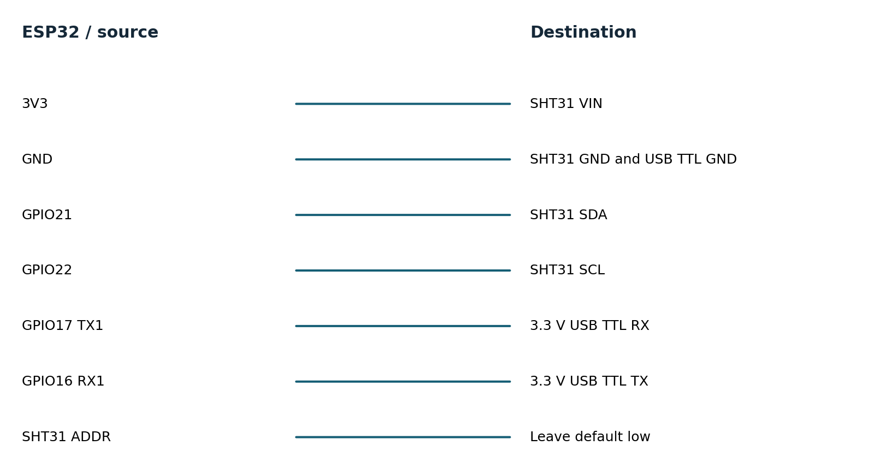
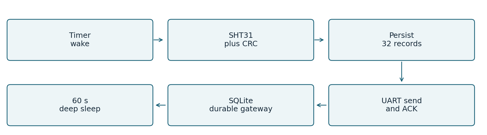
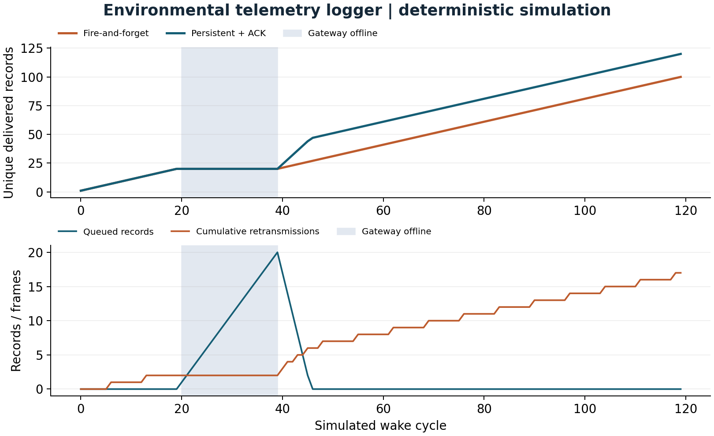

# Environmental telemetry logger

Persistent records and acknowledged delivery across outages

Environmental telemetry logger

Persistent records and acknowledged delivery across outages

Engineering report  |  11 November 2026  |  AI-assisted implementation

A hobby greenhouse operator wants temperature and humidity history even when the nearby gateway is unavailable. This prototype samples an SHT31, keeps a bounded persistent queue, sends records over a local 3.3 V UART link, and sleeps between cycles. UART is a bench link; remote deployment would need a suitable physical layer.

Verified scope: portable C++ tests and deterministic simulations, host integration where applicable, and actual ESP32 cross-compilation. No board was flashed, sensor exercised, or physical measurement collected.

## Requirements and acceptance

| ID | Target established before testing | Verification status |
| --- | --- | --- |
| E1 | SHT31 0x44; 100 kHz; 20 ms conversion wait; CRC validation | Mocked transaction and corruption tests pass |
| E2 | 32-record queue; version and CRC; <1 KiB store | 284-byte format checked on host and target |
| E3 | 3 attempts x 250 ms; at most 4 records/wake | Outage model and real local gateway tests pass |
| E4 | Drop newest on overflow; no send before successful save | Core policy tested; NVS faults need board |
| E5 | 60 s sleep; <5 s active wake target | Sleep configured; power/timing unmeasured |

Targets remain targets until their corresponding environment is tested. This report distinguishes synthetic behavior, host wall-clock execution and linker resource counts. Hardware timing, current, electrical recovery and watchdog reset remain pending.

## Hardware and wiring

Target: classic ESP32-WROOM-32 DevKitC with 4 MB flash. One board can be reused across the three projects. Use the specified 3.3 V interfaces; WROVER pin availability differs.

| Component | Qty | Planning cost |
| --- | --- | --- |
| ESP32 DevKitC WROOM 4 MB | 1 | USD 10-18 estimate |
| Adafruit SHT31 2857 | 1 | USD 13.95 observed |
| 3.3 V USB TTL adapter | 1 | USD 5-12 estimate |
| USB cable, breadboard, jumpers | 1 set | USD 3-5 estimate |

Sensor prices were observed on the cited supplier pages on 11 November 2026. Other costs are estimates in USD, excluding tax, shipping and measurement instruments.

Connection diagram names signal endpoints, not physical header positions. Consult the board silk screen. Use a common ground and short leads. Start with a low-voltage bench setup; industrial-voltage inputs need a suitable interface. See hardware.md for pin notes and instrument requirements.

## Firmware architecture and decisions

The SHT31 driver issues command 0x2400, waits 20 ms and requests six bytes. Both two-byte fields must match CRC-8 polynomial 0x31 initialized to 0xff. Invalid or incomplete readings do not enter the queue. Integer centi-units avoid floating-point formatting ambiguity.

A 284-byte versioned store includes the queue, sequence allocator and drop counter plus CRC-32. It is saved as one NVS blob before any record is sent. A corrupt existing blob faults closed; it is not silently replaced with sequence 1. The format is little-endian and tied to this ABI; the static assertion catches layout changes.

ACK must match the oldest sequence. Each record gets at most three attempts of 250 ms; at most four records are tried per wake. Parser buffers and per-iteration input byte counts are bounded, so an endless noisy stream cannot indefinitely extend a deadline.

The gateway validates payload CRC, ranges and format, then commits SQLite with synchronous FULL. A duplicate with the same payload is acknowledged; a conflicting reuse of the same device/sequence ID is refused. The transaction is durable before ACK. This provides at-least-once transmission and deduplicated storage, not exactly-once transport.

One Arduino task owns the bus, queue and NVS. The task watchdog bounds unexpected hangs. Radio functions are not started. Deep sleep is configured after serial flush; development-board regulator, LEDs and USB circuitry mean low chip sleep current does not imply low board current.

### Ownership of the implementation

Project code implements drivers, calculations, state machines, queue/parser policy, tests and tools. Arduino ESP32 provides the peripheral HAL and startup; ESP-IDF provides FreeRTOS, NVS, watchdog and sleep services. The environmental gateway uses SQLite transactions. Official GitHub drivers were studied as references; they were not copied into these custom headers.

## Testing and evidence

| Requirement | Test or experiment | Result |
| --- | --- | --- |
| E1 | Reference CRC; 48 single-bit corruptions; short frame; mocked NACK/read failure | PASS host |
| E2 | 32-slot overflow, corrupted bytes, serialized reload, sequence exhaustion | PASS host |
| E3 | 20-wake outage, lost ACK, backlog drain, duplicate suppression | PASS simulation |
| E3 | C++ frames through Python subprocess; real SQLite restart; storage error | PASS host integration |
| E4 | Oversized line, CRC/range errors, conflicting sequence reuse | PASS host |
| E2/E5 | NVS power cut, stuck I2C bus, sleep current, real UART timing | PENDING hardware |

Host tests compile the same portable headers used by target firmware. Strict compiler warnings, AddressSanitizer and UndefinedBehaviorSanitizer are enabled in separate test runs. Bus mocks validate transactions and selected faults; they do not reproduce analog behavior or peripheral timing.

PASS 420 assertions: CRC, mocked I2C, overflow, ACK, restart, corrupt storage

Recorded extended loop: 60.000104 seconds and 17,647,800 workload iterations. This is one short host stress run, not a field endurance qualification. Three additional approximately five-second repetitions provide throughput variability.

Five Python gateway integration tests passed, including actual subprocess restarts, real SQLite deduplication and failure to acknowledge when storage errors occur.

Evidence is retained in tests.txt, sanitizers.txt, trace.csv, soak.json, extended-soak.json and build logs. test-matrix.csv maps requirements to results. Original failures remain in initial-tests.txt. No hardware test is marked passed on the strength of a simulation.

## Baseline and improved performance

| Metric | Baseline | Improved | Unit |
| --- | --- | --- | --- |
| Delivery fraction | 83.3333 | 100 | percent |
| Duplicate transmissions | 0 | 17 | frames |

On the same 120-wake trace, delivery rises from 100 to 120 records: 16.67 percentage points, or 20 percent more delivered records relative to baseline. Reliability introduces 17 duplicate received frames when ACKs are lost. Deduplication preserves one database record per identity. Longer outages can still overflow the queue.

## Measurement definitions and limitations

### M04 Delivery fraction

Definition: Unique delivered sequence IDs / generated readings. Method: Run fire-and-forget and persistent queue on identical online trace. Workload: 120 wakes; offline wakes 20..39; first ACK lost for sequences divisible by 7. Samples: 120 generated readings.

Environment: deterministic host simulation of shared C++ logic. Baseline: 83.3333; improved: 100 percent. Limits: Outage shorter than capacity; no real UART or NVS timing.

### M05 Duplicate transmissions

Definition: Data frames received after their ID was already received. Method: Set insertion failure counter in model. Workload: Same outage and ACK-loss workload as M04. Samples: 120 readings; 197 final attempts.

Environment: deterministic host simulation of shared C++ logic. Baseline: 0; improved: 17 frames. Limits: Reliability costs extra transmissions; SQLite dedup checked separately.

### Resource counts and host execution

M08 Firmware flash footprint: 315,701 bytes. Parse target linker size report. 1 target build. Baseline: not measured. No baseline firmware image; static RAM excludes runtime heap, queues and task stacks.

M09 Firmware static RAM: 23,516 bytes. Parse target linker size report. 1 target build. Baseline: not measured. No baseline firmware image; static RAM excludes runtime heap, queues and task stacks.

M10 Host core throughput: 294,146.0305 units/s. steady_clock around compiled C++ core; observable checksum. 3 repetitions, durations 5.000044s,5.000237s,5.000090s. Baseline: not measured. Desktop benchmark only; no baseline speedup claim; min=293974.73050295573 max=296577.3752902287.

Target build: Xtensa GCC 8.4.0, Arduino ESP32 2.0.17 and PlatformIO Espressif platform 6.9.0. Host: macOS-26.2-arm64-arm-64bit; C++17 -O2; portable application core. The complete nine-field metric records and machine-readable values are in evidence/metrics.csv and metrics.json. Physical latency, stack use, CPU load, current and battery life are not reported as measured.

## Failures recovery and remaining risks

### Observed failures and review fixes

The initial store-size assertion expected 288 bytes; compilation established the actual layout is 284 bytes and the assertion was corrected before recording final results. Review also tightened gateway sequence-conflict checks inside the transaction so competing writers cannot cause a conflicting payload to be acknowledged.

### Current limitations

A 32-record queue cannot survive an unbounded outage. At one reading per wake, it covers roughly 32 wake cycles, not exactly 32 minutes because the sleep interval follows active work. Flash writes every wake and ACK create wear; endurance has not been measured. Persistent format migration, secure authentication, real-time timestamps and a long-distance link are not implemented. CRC protects against accidental corruption, not an attacker. A stuck I2C line is retried on a later wake; no automatic bus-clock recovery is claimed.

### Hardware acceptance experiments

1. Measure current with a current profiler or shunt and oscilloscope over 30 complete wake/sleep cycles, disconnecting USB and avoiding back-power from UART. Integrate current over time. Report board input voltage, active time and mean sleep current before estimating battery life.

2. Disconnect the gateway for 20 wakes, restore it and compare generated sequence IDs with database rows. Then exceed 32 queued records to confirm newest-sample drops. Interrupt power during NVS save and after gateway commit but before ACK; inspect duplicates and retained records.

3. Hold SDA low and remove the sensor independently. Confirm bounded wake duration and no malformed record. Restore the sensor and measure the next valid wake. Force a watchdog timeout in a disposable test build and record reset reason.

The engineering-review.md companion records resource budgets, failure modes and release gates. A change should update its requirements, test matrix and comparison trace together; preserve the original workload so before/after values remain comparable.

## Reproduce demonstrate and explain

Prerequisites: C++17 compiler, Python 3.9 or later, and a terminal. The simulation and C++ tests require no board or paid service. From the project directory:

    sh tools/test.sh
    sh tools/sanitize.sh
    sh tools/simulate.sh > evidence/trace.csv
    python3 -m venv .venv
    .venv/bin/pip install -r tools/requirements.txt
    .venv/bin/python tools/benchmark.py --rerun
    .venv/bin/python tools/figures.py
    .venv/bin/pio run -e esp32dev -e simulated
On Windows, activate the virtual environment and use its Scripts executables; run shell scripts through WSL or a compatible shell. Flash only when the matching board is attached: pio run -e esp32dev -t upload --upload-port PORT. Use pio device monitor --port PORT -b 115200. The simulated firmware environment generates inputs on a physical ESP32; the host simulator runs on the computer.

### Demonstration sequence

1. Run sh tools/test.sh and sh tools/simulate.sh.

2. Run python3 tests/test_gateway.py; show the actual process restart and duplicate tests.

3. Inspect trace.csv at wakes 20, 39 and after reconnect. Compare retained records and baseline losses.

4. Explain the ACK-loss duplicate counter and why the database still has one row per ID.

The mentor-guide.md companion contains a beginner explanation, code walkthrough, ten interview questions with answers, independent exercises and three evidence-based resume bullets. Development was AI-assisted; no independent hardware work or production deployment experience is implied.

### Primary references

ADXL345 Rev G datasheet: https://www.analog.com/media/en/technical-documentation/data-sheets/adxl345.pdf

SHT3x DIS version 7 datasheet: https://sensirion.com/media/documents/213E6A3B/63A5A569/Datasheet_SHT3x_DIS.pdf

ESP32 DevKitC guide: https://docs.espressif.com/projects/esp-idf/en/v4.4.7/esp32/hw-reference/esp32/get-started-devkitc.html

ESP32 watchdog API: https://docs.espressif.com/projects/esp-idf/en/v4.4.7/esp32/api-reference/system/wdts.html

Pinned platform definition: https://github.com/platformio/platform-espressif32/blob/v6.9.0/platform.json

See references.md for the pinned GitHub driver study, supplier links and implementation attribution.

